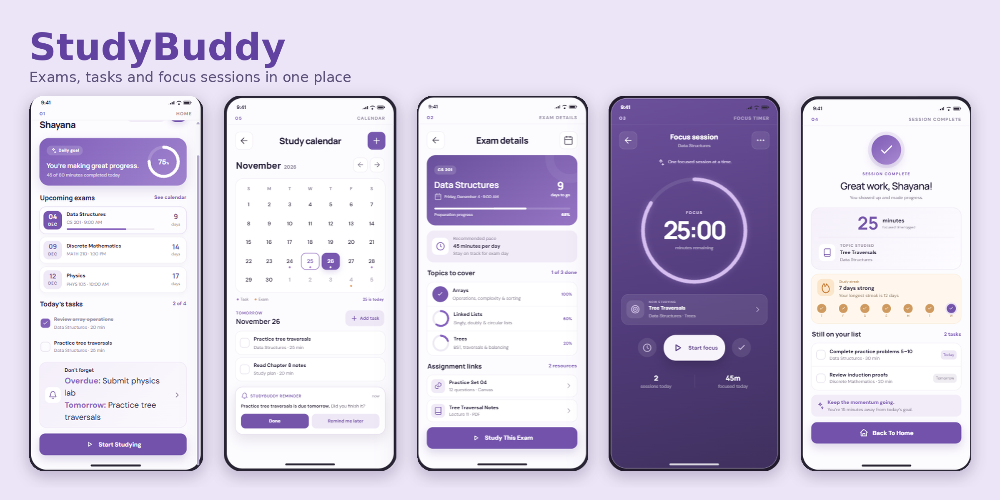

# StudyBuddy 📚
A mobile app prototype that helps college students track exams, daily tasks and focus sessions in one place.

🔗 **Live prototype:** https://hazel-kindle-22835778.figma.site

## Features
- Home with upcoming exams and a "Don't forget" card
- Study calendar with daily to-do lists
- Exam details with topics and assignment links
- 25-minute focus timer
- Session summary with study streak
- Reminder concept (1 day before the due date)

## Built with
Figma Make (AI prototyping), made for Handshake AI Skills Studio.
## Note
Prototype only. Reminders are a design concept, and a real version would need a backend.

